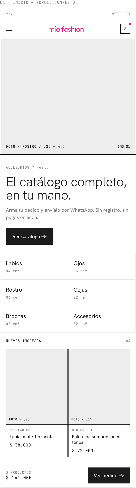
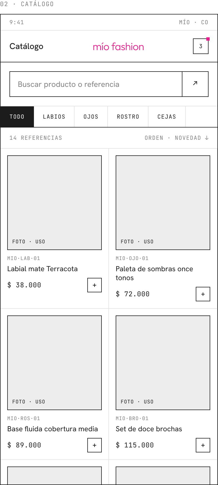
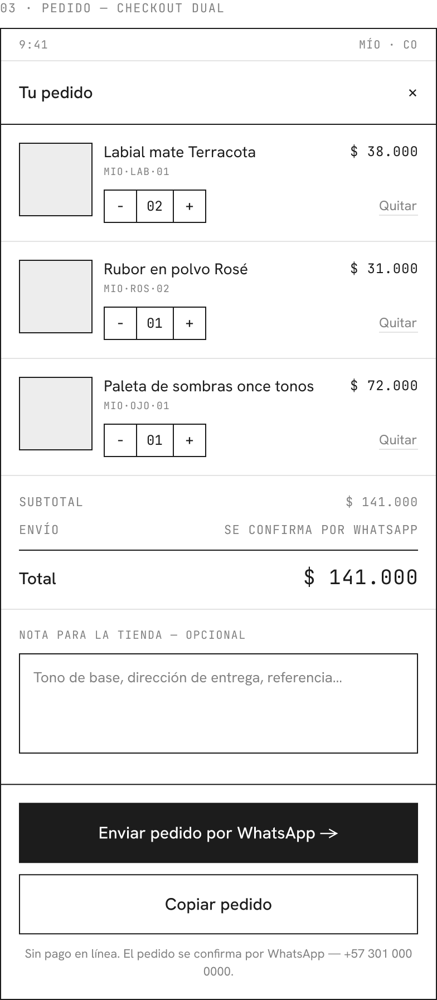
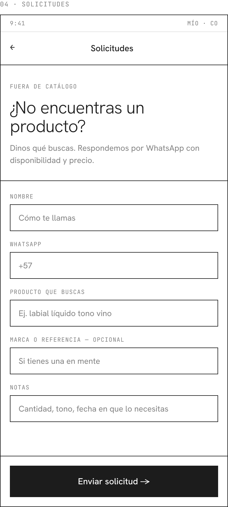
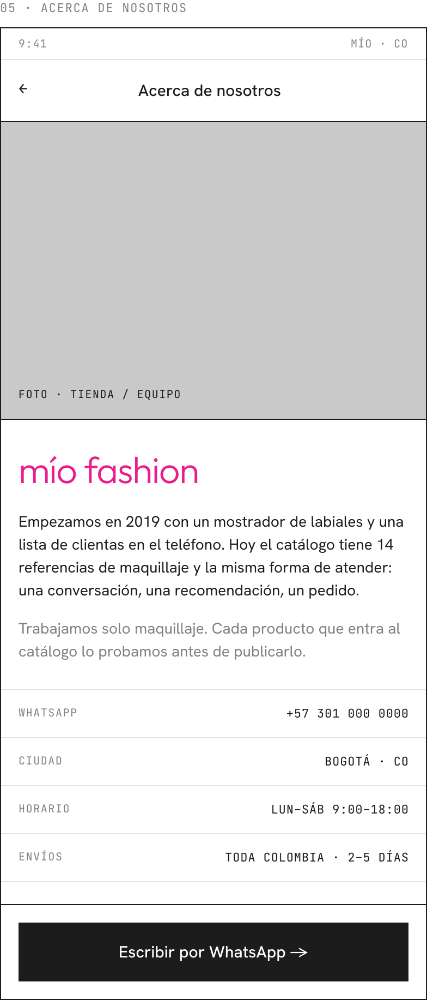
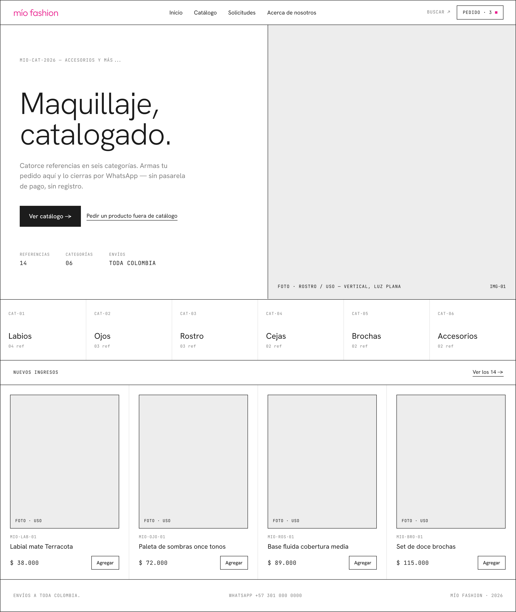
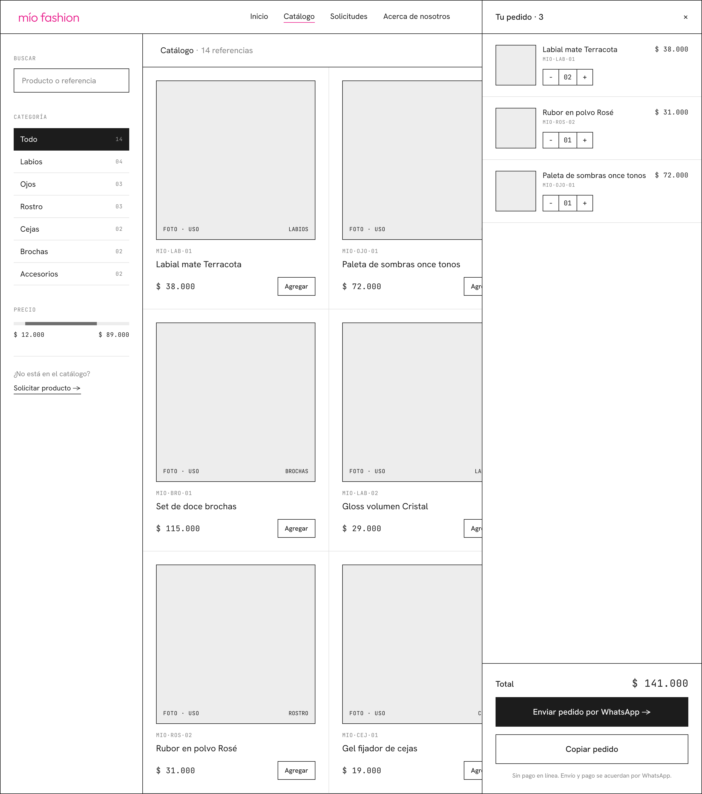
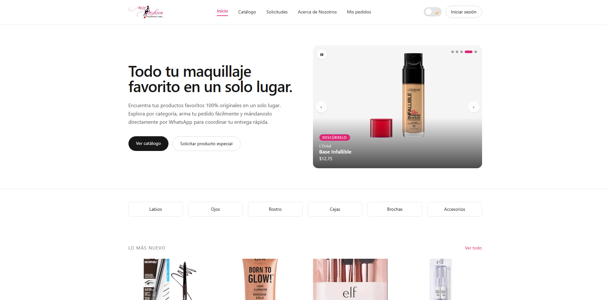
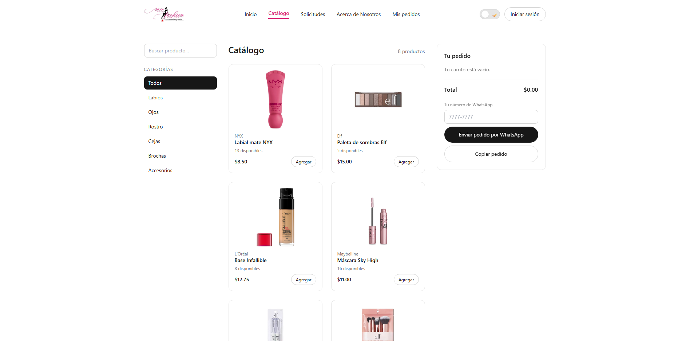

# Mío Fashion — Aplicación Web (React)

Proyecto de cátedra — Entrega final (proyecto web completo).
Asignatura: Desarrollo de Aplicaciones Web con Software Interpretados en el Cliente (DAW901).
Universidad Don Bosco.

**Estudiante:** Melani Adriana Flores Mendoza — FM250096
**Docente:** Alexander Alberto Siguenza

## Enlace del despliegue

https://mio-fashion.vercel.app

## Repositorio

https://github.com/MelaniFlores/mio-fashion

## Descripción

Aplicación web para Mío Fashion, emprendimiento salvadoreño de venta de maquillaje que opera a través de redes
sociales. Esta versión migra los módulos desarrollados en JavaScript vanilla (Etapa 2) a **React**, con una
arquitectura de componentes reutilizables y estado global compartido.

## Cómo ejecutarlo

```bash
npm install
npm run dev        # desarrollo en http://localhost:5173
npm run build      # versión de producción en /dist
```

Para subir imágenes a Cloudinary, copia `.env.example` como `.env` y completa los dos valores
(ver "Subida de imágenes"). Sin ese archivo todo funciona igual: las imágenes se guardan en el navegador (modo de prueba).

## Tecnologías

- React 18 + Vite
- React Router 6 (rutas y rutas protegidas por rol)
- Context API + `useReducer` (estado global)
- Tailwind CSS 3
- Chart.js con react-chartjs-2 (gráficas)
- SweetAlert2 (alertas y confirmaciones)
- localStorage (persistencia)
- APIs externas: **Makeup API** (productos reales de maquillaje) y **Cloudinary** (subida de imágenes)

## Cumplimiento de los requisitos del Avance 2

| # | Requisito | Dónde está |
|---|-----------|------------|
| 1 | Integración del framework en los módulos principales | Todas las vistas son componentes React: `src/pages/` (Inicio, Catálogo, Login, Solicitudes, Mis pedidos, Dashboard, Acerca de nosotros) |
| 2 | Consumo de API externa con datos reales | `src/components/InspiracionApi.jsx` (Makeup API, con hook `useFetch`) y `src/lib/cloudinary.js` (Cloudinary) |
| 3 | Módulos secundarios | Carrusel del inicio, línea de tiempo "Nuestra historia", estados de pedidos, filtros por año y trimestre, recomendaciones automáticas, switch de modo oscuro |
| 4 | Manejo de estado y componentes reutilizables | `src/context/` (Auth, Products, Cart, Orders, Theme) y `src/components/` |
| 5 | Documento PDF con la investigación (APA 7) | Se entrega aparte |

## Estructura del proyecto

```
src/
├── main.jsx                 Punto de entrada y proveedores de contexto
├── App.jsx                  Rutas
├── context/                 Estado global
│   ├── AuthContext          Sesión, login, registro y roles
│   ├── ProductsContext      Productos (CRUD, stock, destacados) con useReducer
│   ├── CartContext          Carrito con useReducer
│   ├── OrdersContext        Pedidos (con estado) y solicitudes
│   └── ThemeContext         Modo oscuro
├── hooks/
│   ├── useLocalStorage      useState / useReducer persistidos
│   ├── useFetch             Consumo de API con carga, error, reintento y caché
│   ├── usePedidosFiltrados  Todas las estadísticas del panel según año y trimestre
│   └── useColoresGrafica    Colores de las gráficas según el tema
├── components/              Navbar, ThemeSwitch, Carousel, ProductCard, CartPanel,
│                            Timeline, Graficas, PedidosAdmin, ProductForm, ImageUploader...
├── pages/                   Una por vista
├── lib/                     Alertas, validaciones, fechas, Cloudinary, datos de ejemplo
└── data/                    Productos iniciales, historia de la empresa, configuración
```

## Módulos

1. **Autenticación**: login y registro con validación, sesión en localStorage y dos roles (cliente y administradora). Las rutas están protegidas con `ProtectedRoute`.
2. **Catálogo y pedidos**: filtro por categoría, buscador, carrito con control de existencias y pedido por WhatsApp o copiado al portapapeles. Al enviar, se descuentan las existencias.
3. **Solicitudes especiales**: formulario validado para productos fuera de catálogo. Se puede llegar con el producto ya escrito desde "Inspiración internacional".
4. **Mis pedidos**: historial del cliente con el estado de cada pedido.
5. **Dashboard de administración**:
   - CRUD de productos con **subida de imágenes** y opción de **destacar** en el carrusel.
   - **Pedidos** con estado (pendiente, pagado, cancelado). Al cancelar se devuelven las existencias y el pedido deja de contarse.
   - Gráficas: pedidos y solicitudes por mes, **productos más vendidos** y **pedidos por año**.
   - **Filtros por año y trimestre** que afectan a las métricas y gráficas.
   - **Recomendaciones automáticas** (stock bajo, pedidos pendientes, productos sin ventas, cancelaciones).
   - Botón de **datos de ejemplo** para ver las gráficas completas en una demostración (se borran con un clic sin tocar los pedidos reales).
6. **Inicio**: carrusel que cambia cada 5 segundos (con pausa), categorías y sección de inspiración con la API.
7. **Acerca de nosotros**: línea de tiempo de la historia de la empresa. Los textos y fotos están en `src/data/historia.js` para editarlos sin tocar código.

## Subida de imágenes (Cloudinary)

1. Crear una cuenta gratis en cloudinary.com.
2. En *Settings → Upload → Add upload preset* crear un preset con *Signing mode: Unsigned*.
3. Copiar `.env.example` como `.env` y completar `VITE_CLOUDINARY_CLOUD_NAME` y `VITE_CLOUDINARY_UPLOAD_PRESET` (no son secretos).
4. En Vercel, agregar las mismas dos variables en *Settings → Environment Variables*.

## Acceso de prueba

Regístrate como cliente desde la pantalla de Iniciar sesión. Para ingresar como administradora, solicita las credenciales al equipo del proyecto.

## Notas y limitaciones

- Los datos viven en `localStorage`, así que cada navegador ve solo lo que se hizo en él. Para uso real con la clienta se necesita una base de datos (por ejemplo Supabase o Firebase) como mejora futura.
- Las contraseñas se guardan sin cifrar porque es un proyecto académico sin servidor.
- Los datos guardados por la versión anterior (JS vanilla) se migran automáticamente al abrir esta versión.
- Si la Makeup API no responde, la sección muestra un mensaje con botón "Reintentar" y el resto del sitio sigue funcionando.

## Mockups de la Etapa 1 (Figma)

Diseños de la Etapa 1 creados en Figma: https://www.figma.com/design/DXCUEDcaiBW3sh7bZ10KD1/Mio-fashion

Son mockups de baja fidelidad (sin fotos de producto, con recuadros grises como marcador). La interfaz final conserva
la estructura de cada pantalla y completa las imágenes, los datos y los módulos de administración.

### Versión móvil

| Inicio | Catálogo | Pedido | Solicitudes | Acerca de nosotros |
|:--:|:--:|:--:|:--:|:--:|
|  |  |  |  |  |

### Versión escritorio

**Inicio**



**Catálogo con panel de pedido**



### Sitio final (capturas)

| Vista | Captura |
|-------|---------|
| Inicio |  |
| Catálogo |  |

## Trabajo en equipo (GitHub)

Una rama por integrante y todos como colaboradores del repositorio.

| Integrante | Carnet | Rama |
|------------|--------|------|
| Melani Adriana Flores Mendoza | FM250096 | `melani` |

## Licencia

Este proyecto se publica bajo la licencia **Creative Commons Atribución 4.0 Internacional (CC BY 4.0)**.
Consulta el archivo [LICENSE](LICENSE) o https://creativecommons.org/licenses/by/4.0/deed.es
